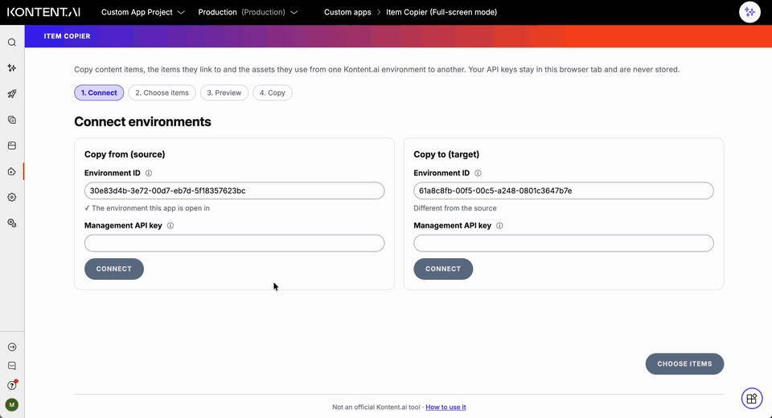
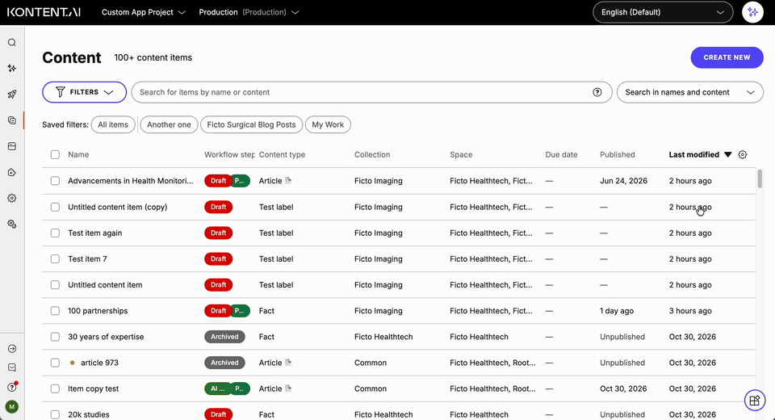

# Item Copier for Kontent.ai

A tool for [Kontent.ai](https://kontent.ai/) users who need to copy content items, the items they link to and the assets they use from one environment to another, without scripts or a command line. You can try it out [here](https://item-copier.netlify.app/).

It runs entirely in your browser. There is no server, and your API keys are never stored: they're gone when you close or reload the tab. The copying itself is done by Kontent.ai's [migration toolkit](https://github.com/kontent-ai/migration-toolkit).





## What does it do?

- **Finds the items to copy**: search by name or text, and filter by content type, collection, workflow step or taxonomy term.
- **Pulls in linked items**: 1 to 3 levels deep, or every linked item, in each language you choose.
- **Copies the assets** the items use, with their folders where the target has them.
- **Previews every change before anything is written**: which items are new, which overwrite existing ones, and what will be published or unpublished in the target.
- **Checks the target first**: missing content types, elements, taxonomy terms, collections, languages and workflows block the copy, with a message saying how to fix each one.
- **Handles publishing your way**: match the source's publishing states and schedules, or copy everything as drafts without publishing or unpublishing anything.
- **Shows the copy as it happens** in a progress log, and lets you cancel between items.
- **Links to every copied item** in the target, and gives you a report to download.

## Who is it for?

- **Content editors and managers** who need to move content between environments, for example from production to a test environment, or from a sandbox into production.
- **Anyone** who would otherwise use the migration toolkit or data-ops from the command line for a handful of items.

## How does it help?

- **No code:** pick items in a browser instead of writing an import script.
- **Fewer surprises:** the preview shows exactly what will change and catches problems before the copy starts, not halfway through.
- **Safe for live content:** "Copy as drafts" never publishes or unpublishes anything, and anything that overwrites or publishes needs your confirmation.
- **Easy to follow up:** links to the copied items and a downloadable report.

## Before you start

- **Try it on a test environment first.** Copying overwrites items that already exist in the target, and it can't be undone in Item Copier.
- **The target needs the same content model**: content types (with the same elements), taxonomy groups and terms, collections, languages and workflows, matched by codename. The preview tells you what's missing; data-ops `sync` can align the models.
- **Create a Management API key for each environment** in **Project settings > API keys**, with these permissions:
  - Source: _Read content_, _Read assets_, _Manage content model_ and _Manage environment settings_.
  - Target: _Create, edit, and delete content_; _Create, edit, and delete assets_; _Manage content model_; and _Manage environment settings_.

  The tool doesn't change the content model or settings. It needs those two permissions to read content types, taxonomies, languages, collections and workflows. You can also [use a personal API key](#using-a-personal-api-key).

### Using a personal API key

Instead of a Management API key, you can use your own personal API key in each environment. A personal API key has the same permissions as your role, so it works if your role can:

- **In the source**: view content items and assets in the collections and languages you copy.
- **In the target**: view, create and edit content items, and create and edit assets, in those collections and languages.
- **In the target's workflows**: work in the steps the copied items are moved through. If the copy publishes, unpublishes or archives items, your role needs to be allowed to do that in those workflows too.

## How to use it

1. **Connect**: enter the environment ID and API key for the source and the target.
2. **Choose items**: search, filter and tick the items to copy. Under **Copy settings**, choose the languages, how many levels of linked items to include, and whether to skip references to deleted items and assets.
3. **Preview**: check what will happen to each item. Errors at the top block the copy and say how to fix the cause. Choose how publishing is handled:
   - **Match the source**: items end up published, unpublished, scheduled or archived as in the source. This can publish or unpublish items in the target right away.
   - **Copy as drafts**: nothing is published or unpublished. Items published in the target stay published, with the copied content as a new draft.
4. **Copy**: confirm, then follow the progress log. When it finishes, open the copied items in the target or download the report.

## Good to know

- **Keep the tab open** while the copy runs; closing it stops the copy. To stop, use **Cancel copy**, which finishes the current item first.
- **Copying again is safe**: existing items and assets are updated, not duplicated.
- **It takes a while for large copies**: requests are paced to half of the Management API's rate limits, so the tool doesn't slow down other work in your environments. About 65 language variants take 3 minutes.
- **Not copied**: the source items' version history, comments, tasks and assignees.
- **Deleted references**: the copy stops on a reference to an item or asset that no longer exists, unless you skip such references. The preview tells you when there are any.

## Running as a Kontent.ai custom app

The tool can also run inside Kontent.ai as a [custom app](https://kontent.ai/learn/docs/custom-apps), pointed at wherever you've deployed it:

1. In Kontent.ai, go to **Environment settings > Custom apps** and click **Create new custom app**.
2. Enter a name and the hosted URL, for example `https://item-copier.netlify.app/`.
3. Choose the roles that can use it, and the **Full screen** or **Dialog** display mode (see below).
4. Optionally, add settings in **Parameters {JSON}** (see below), then click **Save changes**.

In **Full screen** mode, each environment on the Connect step offers **Use this environment**, which fills in the ID of the environment the app is opened in. You still enter the API keys yourself.

### Dialog mode

In **Dialog** mode, the tool opens next to the page you're on, and you choose items in Kontent.ai itself instead of searching for them:

1. Open the content inventory and select items with their checkboxes, or open an item to copy that item. The checkbox in the inventory's header selects every item that matches the inventory's filters, including ones the listing doesn't show.
2. Open Item Copier from the custom apps dialog. The source is the environment you're in; enter its API key and the target environment.
3. On **Choose items**, the list shows what's selected in Kontent.ai and updates as you change the selection. Copy settings, the preview and the copy work as in full screen. If you change the selection after opening the preview, the preview says so and offers **Update preview**; until then, the copy uses the items in the preview.

The dialog doesn't keep anything when it's closed, so you enter the API keys each time you open it, and closing it while a copy runs stops the copy.

### Configuring the custom app

No settings are needed. To fill in environment IDs automatically (in Dialog mode, only `targetEnvironmentId` is used), for example when content is regularly copied from this environment to a specific other one, add:

```json
{
  "thisEnvironment": "source",
  "targetEnvironmentId": "975bf280-fd91-488c-994c-2f04416e5ee3"
}
```

- `thisEnvironment`: `"source"` or `"target"`, to fill that side with the environment the app is opened in.
- `sourceEnvironmentId`, `targetEnvironmentId`: an environment ID for either side. These take precedence over `thisEnvironment`.

To try a local version as a custom app, run `npm run dev`, open the HTTPS address it prints once in your browser and accept the certificate warning (the certificate is self-signed), then use that address as the custom app's hosted URL.

API keys can't be added to the settings. Kontent.ai's documentation advises against storing API keys in custom app parameters, because anyone who can open the app can read them, and this tool's keys can create, edit and delete content.

## Deploying

Netlify makes it easy to deploy and host your own copy. The button below guides you through deploying it to Netlify and leaves you with a copy of the repository in your GitHub account.

[](https://app.netlify.com/start/deploy?repository=https://github.com/mjstackhouse/item-copier)

`netlify.toml` sets the build and the security headers. If you host it elsewhere, set the same headers, and make sure the build runs npm's install scripts, which apply the patches the tool needs.

## Developing

```bash
npm install      # also applies the toolkit patches in patches/
npm run dev      # local dev server over HTTPS (npm run dev:http for plain HTTP)
npm test         # unit tests
npm run lint     # formatting and lint checks
npm run build    # typecheck and production build
```

How it works, the toolkit patches, testing against real environments and upgrading the toolkit are covered in the [developer guide](docs/DEVELOPMENT.md).

## License

[MIT](LICENSE)
